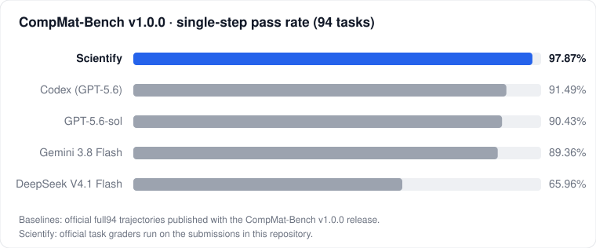

# Scientify · traceable benchmark results

[中文](README.zh-CN.md)

Results of [Scientify](https://scientify.tech), an autonomous research agent that works in a cloud computer
with scientific software installed, on public computational chemistry and materials benchmarks.

Every benchmark folder holds the submitted answer for each task, the full output of the benchmark's own grader,
checksums of the complete submissions, and a script that regrades everything from scratch with the official
graders. Nothing in the reported score depends on our own scoring code.

| Benchmark | Proposed by | What it tests | Tasks | Scientify | Best published | |
|---|---|---|---:|---:|---:|---|
| [**CompMat-Bench**](compmat-bench/) v1.0.0 · single-step | Rice University | Preparing simulation inputs and analysing computed data in computational materials research | 94 | **97.87 %** | 91.49 % | [report](compmat-bench/README.md) |
| MDArena v0.2.0 | University of Oxford | End-to-end molecular dynamics workflows | 50 | | | coming |
| INCARBench v1 | Nankai University | Writing and repairing VASP INCAR parameters | 768 | | | coming |

<p align="center"></p>

## Regrade

```sh
git clone https://github.com/tsingyuai/scientify-benchmarks
cd scientify-benchmarks/compmat-bench/regrade
./run.sh        # Docker required; downloads the official benchmark release and our submissions
```

## Licence

Scripts in this repository are released under the MIT licence. Results and submissions are released under
CC BY 4.0. Benchmark tasks, inputs and graders belong to their authors and keep their own licences.
