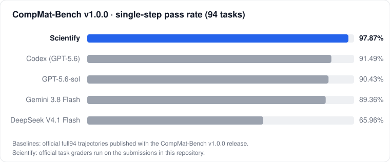

# Scientify · 可追溯的榜单结果

[English](README.md)

[Scientify](https://scientify.tech) 是在预装科研软件的云电脑中自主工作的科学智能体。本仓库公开它在计算化学与计算材料公开榜单上的结果。

每个榜单目录包含每道题提交的答案、榜单官方评分器的完整输出、全部提交文件的校验和，以及一个从零开始、只用官方评分器重新评分的脚本。公布的分数不依赖我们自己的评分代码。

| 榜单 | 提出单位 | 考察能力 | 题数 | Scientify | 已公开最好成绩 | |
|---|---|---|---:|---:|---:|---|
| [**CompMat-Bench**](compmat-bench/) v1.0.0 · 单步 | 莱斯大学 | 计算材料研究中的计算输入准备与计算数据分析 | 94 | **97.87 %** | 91.49 % | [报告](compmat-bench/README.md) |
| MDArena v0.2.0 | 牛津大学 | 分子动力学全流程 | 50 | | | 即将公开 |
| INCARBench v1 | 南开大学 | VASP INCAR 参数的编写与修复 | 768 | | | 即将公开 |

<p align="center"></p>

## 独立复核

```sh
git clone https://github.com/tsingyuai/scientify-benchmarks
cd scientify-benchmarks/compmat-bench/regrade
./run.sh        # 需要 Docker；脚本会下载官方榜单发布包与我们的提交
```

## 许可

仓库中的脚本以 MIT 许可发布，结果与提交文件以 CC BY 4.0 发布。榜单题目、输入与评分器归原作者所有，沿用其原有许可。
