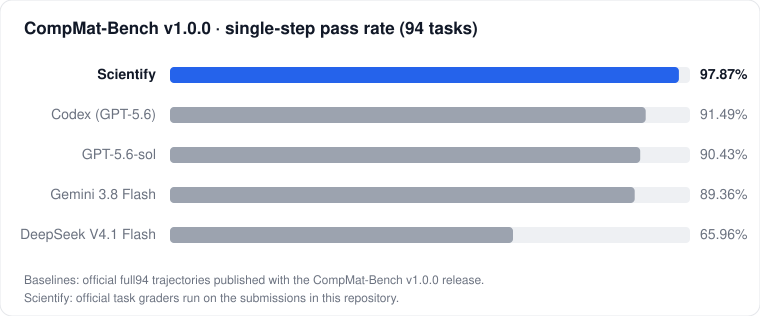
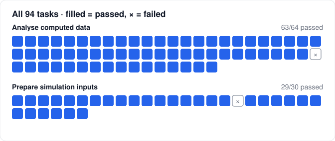

# CompMat-Bench v1.0.0 · Scientify results

<p align="center"></p>

| | |
|---|---|
| **Pass rate** | **92 / 94 = 97.87 %** (best published baseline: 86 / 94 = 91.49 %) |
| **Grader checks passed** | **2349 / 2362** |
| **Benchmark** | [CompMat-Bench](https://github.com/cz2014/CompMat-Bench) v1.0.0, single-step split (full94) · Rice University · [arXiv:2610.00636](https://arxiv.org/abs/2610.00636) |
| **Scoring** | Official task graders of the v1.0.0 release, run on the submissions in this repository |
| **Agent** | Scientify |
| **Run dates** | 2026-10-30 to 2026-11-01 |

## What CompMat-Bench measures

CompMat-Bench turns recently published computational materials studies (September 2025 to March 2026) into
tasks an agent must complete inside a working directory. Each single-step task supplies the files a researcher
would have at that point of the study and asks for one well-defined step. The grader then checks the result
against frozen references and physics-based rules, task by task, and the task scores 1 only if every required
check passes.

The 94 tasks fall into two kinds of work:

| Kind | Tasks | What the agent has to get right |
|---|---:|---|
| **Prepare simulation inputs** | 30 | Build structures and write complete input decks for VASP, Quantum ESPRESSO, ABACUS, Wannier90 or LAMMPS: the right calculation type, k-mesh, smearing, spin and DFT+U settings, constraints and output requests for the physics in question. |
| **Analyse computed data** | 64 | Read raw outputs of real calculations (band structures, phonons, Monte Carlo sweeps, force constants, transport tables) and extract the physical quantities the study reports: gaps, exchange constants, Néel temperatures, thermal conductivities, dielectric responses, saddle points. |

The systems span Heusler alloys, WS₂/WSe₂ moiré bilayers, the MnTe altermagnet, HfZrO ferroelectrics, BaTiO₃
dislocations, Si/Ge interfaces, CrN magnetism and phonon transport in BAs. A single task is checked by between
2 and 294 grader rules; the whole split has 2362.

## Results by task

<p align="center"></p>

Two tasks did not pass:

| Task | What the grader found |
|---|---|
| `task_202603_002_step_zno-finite-strain-inputs`<br>Quantum ESPRESSO decks for the finite-strain elastic and piezoelectric response of wurtzite ZnO | The Berry-phase runs used `calculation='scf'` instead of `nscf`, and a k-mesh with 6 subdivisions along the string direction where the frozen minimum is 8 (84 of 95 checks passed). |
| `task_202603_019_step_si-ge-abinitio-phonons`<br>Harmonic phonons and lattice thermal conductivity of bulk Si and Ge | The 300 K thermal conductivities, 81.5 and 36.9 W m⁻¹ K⁻¹ for Si and Ge, fall outside the ±10 % band around the reference values 123.4 and 61.3 (14 of 16 checks passed). |

The complete per-task table is at the end of this page and in [`results.csv`](results.csv) / [`results.json`](results.json).

## Regrade it yourself

```sh
git clone https://github.com/tsingyuai/scientify-benchmarks
cd scientify-benchmarks/compmat-bench/regrade
./run.sh
```

`run.sh` needs Docker and about 3 GB of disk. It:

1. downloads `compmat_bench_core.zip` from the official CompMat-Bench v1.0.0 release and checks it against the
   release's own `CHECKSUMS.sha256`;
2. downloads the Scientify submissions from this repository's release and checks every archive against
   [`SHA256SUMS`](SHA256SUMS);
3. builds a grading image with Python 3.11, the packages listed in the benchmark's `docs/evaluation.md`
   (pinned in [`regrade/requirements.txt`](regrade/requirements.txt)) and the Wannier90 3.1.0 input reader built
   with the benchmark's own builder;
4. confirms that all 94 official reference submissions score 1 in that image;
5. runs each task's official `grader.py` on the matching Scientify submission and compares every score with
   [`results.csv`](results.csv).

Expected last lines:

```
regraded 94/94 tasks, passed 92, pass rate 97.87%
matches results.csv
```

## Run setup

- **Isolation.** Each task ran in its own Scientify cloud workspace created from the task's `agent/` directory,
  with the software the benchmark allows for single-step tasks. Graders and reference submissions were not
  copied into the workspace; grading ran afterwards on a separate machine.
- **Resources.** 4 CPU cores and 8 GiB of memory per task. The benchmark's published single-step profile is
  4 CPU cores and 16 GiB.
- **Format repairs.** In three tasks the scientific content was complete but the official static grader could
  not parse the submitted files. The files were rewritten into the form the grader reads, without changing any
  scientific parameter; the published submissions are the repaired ones and are graded as they are.

  | Task | Grader could not read | Rewrite |
  |---|---|---|
  | `task_202603_011_step_crn-wannier-exchange-inputs` | The shell script assumed non-official spin prefixes and used conditional shell operators rejected by the static grader. VASP writes wannier90.1 and wannier90.2 for the two spin channels. | Mapped the prefixes to wannier90.1 and wannier90.2, wrote the staged DOSCAR Fermi energy explicitly, and emitted the same TB2J command without shell control operators. Model-selected kmesh, rcut, E_F source, and output path were preserved. |
  | `task_202603_031_step_batio3-hysteresis-lammps-inputs` | The submitted decks used include potential.inc, while the prompt required the parameters in the decks and the grader parses only deck text. | The same potential block was inlined into pole.in and loop.in without changing its scientific parameters; no scientific calculation was rerun. |
  | `task_202603_033_step_batio3-dislocation-dipole-inputs` | The official static grader only accepts relaxation-loop exit conditionals and rejected an otherwise valid two-phase LAMMPS conditional that dispatched write_data and unfix commands. | The same field-on and field-free phases were expanded into ordered static blocks without changing the potential, field, minimization, convergence thresholds, structure, or output filenames. |

- **Published files.** Each submission archive is the task's working directory as the agent left it, without
  the agent's own notes (`research/`). Session transcripts are not part of this release.

## Repository layout

```
compmat-bench/
├── results.json / results.csv   per-task score, grader checks, SHA-256 of the submission
├── SHA256SUMS                   checksums of the 94 submission archives in the release
├── tasks/<task_id>/
│   ├── answer.json              the submitted answer (POSCARs for the Heusler structure task)
│   └── grade.txt                full output of the official grader
├── assets/                      charts used on this page
├── regrade/                     Dockerfile, pinned requirements and scripts for independent regrading
└── tools/                       script that builds results and charts from grader output
```

The 94 complete submission archives (≈470 MB) are attached to the
[`compmat-bench-v1.0.0-submissions`](https://github.com/tsingyuai/scientify-benchmarks/releases/tag/compmat-bench-v1.0.0-submissions)
release. Task prompts and inputs are in the [CompMat-Bench repository](https://github.com/cz2014/CompMat-Bench/tree/v1.0.0/tasks).

## All 94 tasks

| Task | Kind | Codes | Checks | Score |
|---|---|---|---:|:---:|
| [task_202509_001 · hbn-sliding-sweep-inputs](https://github.com/cz2014/CompMat-Bench/blob/v1.0.0/tasks/task_202509_001_step_hbn-sliding-sweep-inputs/agent/prompt.md) | inputs | vasp | 169/169 | ✅ |
| [task_202509_002 · hbn-sliding-potential-step](https://github.com/cz2014/CompMat-Bench/blob/v1.0.0/tasks/task_202509_002_step_hbn-sliding-potential-step/agent/prompt.md) | analysis | vasp | 4/4 | ✅ |
| [task_202509_003 · hbn-undulated-sliding-ratio](https://github.com/cz2014/CompMat-Bench/blob/v1.0.0/tasks/task_202509_003_step_hbn-undulated-sliding-ratio/agent/prompt.md) | analysis | — | 8/8 | ✅ |
| [task_202509_004 · bn-nanotube-inputs](https://github.com/cz2014/CompMat-Bench/blob/v1.0.0/tasks/task_202509_004_step_bn-nanotube-inputs/agent/prompt.md) | inputs | vasp | 28/28 | ✅ |
| [task_202509_005 · bn-nanotube-flexoelectric-constant](https://github.com/cz2014/CompMat-Bench/blob/v1.0.0/tasks/task_202509_005_step_bn-nanotube-flexoelectric-constant/agent/prompt.md) | analysis | vasp | 1/1 | ✅ |
| [task_202509_006 · hbn-flexo-sliding-decomposition-inputs](https://github.com/cz2014/CompMat-Bench/blob/v1.0.0/tasks/task_202509_006_step_hbn-flexo-sliding-decomposition-inputs/agent/prompt.md) | inputs | vasp | 64/64 | ✅ |
| [task_202509_007 · hbn-undulated-step-decomposition](https://github.com/cz2014/CompMat-Bench/blob/v1.0.0/tasks/task_202509_007_step_hbn-undulated-step-decomposition/agent/prompt.md) | analysis | vasp | 14/14 | ✅ |
| [task_202601_001 · v2coal-heusler-structures](https://github.com/cz2014/CompMat-Bench/blob/v1.0.0/tasks/task_202601_001_step_v2coal-heusler-structures/agent/prompt.md) | analysis | — | 2/2 | ✅ |
| [task_202601_002 · v2coal-relax-energy-inputs](https://github.com/cz2014/CompMat-Bench/blob/v1.0.0/tasks/task_202601_002_step_v2coal-relax-energy-inputs/agent/prompt.md) | inputs | vasp | 48/48 | ✅ |
| [task_202601_003 · v2coal-formation-energies-ordering](https://github.com/cz2014/CompMat-Bench/blob/v1.0.0/tasks/task_202601_003_step_v2coal-formation-energies-ordering/agent/prompt.md) | analysis | vasp | 10/10 | ✅ |
| [task_202601_004 · v2coal-l21-abacus-inputs](https://github.com/cz2014/CompMat-Bench/blob/v1.0.0/tasks/task_202601_004_step_v2coal-l21-abacus-inputs/agent/prompt.md) | inputs | abacus | 13/13 | ✅ |
| [task_202601_005 · v2coal-l21-magnetic-moment](https://github.com/cz2014/CompMat-Bench/blob/v1.0.0/tasks/task_202601_005_step_v2coal-l21-magnetic-moment/agent/prompt.md) | analysis | abacus | 2/2 | ✅ |
| [task_202601_006 · v2coal-xa-abacus-inputs](https://github.com/cz2014/CompMat-Bench/blob/v1.0.0/tasks/task_202601_006_step_v2coal-xa-abacus-inputs/agent/prompt.md) | inputs | abacus | 13/13 | ✅ |
| [task_202601_007 · v2coal-xa-site-moments](https://github.com/cz2014/CompMat-Bench/blob/v1.0.0/tasks/task_202601_007_step_v2coal-xa-site-moments/agent/prompt.md) | analysis | abacus | 3/3 | ✅ |
| [task_202601_008 · v2coal-heisenberg-exchange](https://github.com/cz2014/CompMat-Bench/blob/v1.0.0/tasks/task_202601_008_step_v2coal-heisenberg-exchange/agent/prompt.md) | analysis | abacus | 5/5 | ✅ |
| [task_202601_009 · snte-110-surface-dirac-cones](https://github.com/cz2014/CompMat-Bench/blob/v1.0.0/tasks/task_202601_009_step_snte-110-surface-dirac-cones/agent/prompt.md) | analysis | — | 1/1 | ✅ |
| [task_202601_010 · ruo2-snte-interface-inputs](https://github.com/cz2014/CompMat-Bench/blob/v1.0.0/tasks/task_202601_010_step_ruo2-snte-interface-inputs/agent/prompt.md) | inputs | vasp | 38/38 | ✅ |
| [task_202601_011 · coupled-slab-surface-splittings](https://github.com/cz2014/CompMat-Bench/blob/v1.0.0/tasks/task_202601_011_step_coupled-slab-surface-splittings/agent/prompt.md) | analysis | — | 2/2 | ✅ |
| [task_202601_012 · surface-cone-hall-contributions](https://github.com/cz2014/CompMat-Bench/blob/v1.0.0/tasks/task_202601_012_step_surface-cone-hall-contributions/agent/prompt.md) | analysis | — | 0/0 | ✅ |
| [task_202601_013 · slab-hall-interface-distribution](https://github.com/cz2014/CompMat-Bench/blob/v1.0.0/tasks/task_202601_013_step_slab-hall-interface-distribution/agent/prompt.md) | analysis | — | 2/2 | ✅ |
| [task_202602_001 · hgte-well-hartree-inputs](https://github.com/cz2014/CompMat-Bench/blob/v1.0.0/tasks/task_202602_001_step_hgte-well-hartree-inputs/agent/prompt.md) | inputs | — | 48/48 | ✅ |
| [task_202602_002 · hgte-well-hartree-analysis](https://github.com/cz2014/CompMat-Bench/blob/v1.0.0/tasks/task_202602_002_step_hgte-well-hartree-analysis/agent/prompt.md) | analysis | — | 10/10 | ✅ |
| [task_202602_003 · hgte-well-surface-dispersion](https://github.com/cz2014/CompMat-Bench/blob/v1.0.0/tasks/task_202602_003_step_hgte-well-surface-dispersion/agent/prompt.md) | analysis | — | 5/5 | ✅ |
| [task_202602_004 · hgte-well-sdh-densities](https://github.com/cz2014/CompMat-Bench/blob/v1.0.0/tasks/task_202602_004_step_hgte-well-sdh-densities/agent/prompt.md) | analysis | — | 10/10 | ✅ |
| [task_202602_005 · gete-wannier-inputs](https://github.com/cz2014/CompMat-Bench/blob/v1.0.0/tasks/task_202602_005_step_gete-wannier-inputs/agent/prompt.md) | inputs | qe, wannier90 | 40/40 | ✅ |
| [task_202602_006 · gete-fermi-levels](https://github.com/cz2014/CompMat-Bench/blob/v1.0.0/tasks/task_202602_006_step_gete-fermi-levels/agent/prompt.md) | analysis | wannier90 | 5/5 | ✅ |
| [task_202602_007 · gete-interband-jdos](https://github.com/cz2014/CompMat-Bench/blob/v1.0.0/tasks/task_202602_007_step_gete-interband-jdos/agent/prompt.md) | analysis | wannier90 | 8/8 | ✅ |
| [task_202602_008 · gete-optical-conductivity](https://github.com/cz2014/CompMat-Bench/blob/v1.0.0/tasks/task_202602_008_step_gete-optical-conductivity/agent/prompt.md) | analysis | wannier90 | 5/5 | ✅ |
| [task_202602_009 · rucl2-dftu-bands-inputs](https://github.com/cz2014/CompMat-Bench/blob/v1.0.0/tasks/task_202602_009_step_rucl2-dftu-bands-inputs/agent/prompt.md) | inputs | vasp | 29/29 | ✅ |
| [task_202602_010 · rucl2-valley-gaps](https://github.com/cz2014/CompMat-Bench/blob/v1.0.0/tasks/task_202602_010_step_rucl2-valley-gaps/agent/prompt.md) | analysis | vasp | 4/4 | ✅ |
| [task_202602_011 · rucl2-phonon-forces-inputs](https://github.com/cz2014/CompMat-Bench/blob/v1.0.0/tasks/task_202602_011_step_rucl2-phonon-forces-inputs/agent/prompt.md) | inputs | vasp | 15/15 | ✅ |
| [task_202602_012 · rucl2-a1p-phonon-mode](https://github.com/cz2014/CompMat-Bench/blob/v1.0.0/tasks/task_202602_012_step_rucl2-a1p-phonon-mode/agent/prompt.md) | analysis | vasp | 5/5 | ✅ |
| [task_202602_013 · rucl2-frozen-phonon-optics-inputs](https://github.com/cz2014/CompMat-Bench/blob/v1.0.0/tasks/task_202602_013_step_rucl2-frozen-phonon-optics-inputs/agent/prompt.md) | inputs | vasp | 155/155 | ✅ |
| [task_202602_014 · rucl2-magneto-raman-tensor](https://github.com/cz2014/CompMat-Bench/blob/v1.0.0/tasks/task_202602_014_step_rucl2-magneto-raman-tensor/agent/prompt.md) | analysis | vasp | 6/6 | ✅ |
| [task_202602_015 · ws2-wse2-moire-lammps-inputs](https://github.com/cz2014/CompMat-Bench/blob/v1.0.0/tasks/task_202602_015_step_ws2-wse2-moire-lammps-inputs/agent/prompt.md) | inputs | lammps | 24/24 | ✅ |
| [task_202602_016 · ws2-wse2-moire-reconstruction-fields](https://github.com/cz2014/CompMat-Bench/blob/v1.0.0/tasks/task_202602_016_step_ws2-wse2-moire-reconstruction-fields/agent/prompt.md) | analysis | lammps | 17/17 | ✅ |
| [task_202602_017 · ws2-wse2-bilayer-soc-band-inputs](https://github.com/cz2014/CompMat-Bench/blob/v1.0.0/tasks/task_202602_017_step_ws2-wse2-bilayer-soc-band-inputs/agent/prompt.md) | inputs | vasp | 37/37 | ✅ |
| [task_202602_018 · ws2-wse2-band-offsets-at-k](https://github.com/cz2014/CompMat-Bench/blob/v1.0.0/tasks/task_202602_018_step_ws2-wse2-band-offsets-at-k/agent/prompt.md) | analysis | vasp | 5/5 | ✅ |
| [task_202602_019 · tmd-monolayer-strain-sweep-inputs](https://github.com/cz2014/CompMat-Bench/blob/v1.0.0/tasks/task_202602_019_step_tmd-monolayer-strain-sweep-inputs/agent/prompt.md) | inputs | vasp | 294/294 | ✅ |
| [task_202602_020 · tmd-strain-deformation-potentials](https://github.com/cz2014/CompMat-Bench/blob/v1.0.0/tasks/task_202602_020_step_tmd-strain-deformation-potentials/agent/prompt.md) | analysis | vasp | 6/6 | ✅ |
| [task_202602_021 · moire-piezoelectric-bound-charge](https://github.com/cz2014/CompMat-Bench/blob/v1.0.0/tasks/task_202602_021_step_moire-piezoelectric-bound-charge/agent/prompt.md) | analysis | lammps | 7/7 | ✅ |
| [task_202602_022 · moire-screened-piezo-potential](https://github.com/cz2014/CompMat-Bench/blob/v1.0.0/tasks/task_202602_022_step_moire-screened-piezo-potential/agent/prompt.md) | analysis | — | 6/6 | ✅ |
| [task_202602_023 · mnte-altermagnet-pipeline-inputs](https://github.com/cz2014/CompMat-Bench/blob/v1.0.0/tasks/task_202602_023_step_mnte-altermagnet-pipeline-inputs/agent/prompt.md) | inputs | qe | 65/65 | ✅ |
| [task_202602_024 · mnte-altermagnet-spin-splitting](https://github.com/cz2014/CompMat-Bench/blob/v1.0.0/tasks/task_202602_024_step_mnte-altermagnet-spin-splitting/agent/prompt.md) | analysis | qe | 6/6 | ✅ |
| [task_202602_025 · doped-mnte-space-group-classification](https://github.com/cz2014/CompMat-Bench/blob/v1.0.0/tasks/task_202602_025_step_doped-mnte-space-group-classification/agent/prompt.md) | analysis | — | 2/2 | ✅ |
| [task_202602_026 · doped-mnte-supercell-band-inputs](https://github.com/cz2014/CompMat-Bench/blob/v1.0.0/tasks/task_202602_026_step_doped-mnte-supercell-band-inputs/agent/prompt.md) | inputs | qe | 80/80 | ✅ |
| [task_202602_027 · doped-mnte-momentum-spin-splitting](https://github.com/cz2014/CompMat-Bench/blob/v1.0.0/tasks/task_202602_027_step_doped-mnte-momentum-spin-splitting/agent/prompt.md) | analysis | qe | 16/16 | ✅ |
| [task_202602_028 · tb-chain-spin-splitting](https://github.com/cz2014/CompMat-Bench/blob/v1.0.0/tasks/task_202602_028_step_tb-chain-spin-splitting/agent/prompt.md) | analysis | — | 9/9 | ✅ |
| [task_202602_029 · substituted-tb-chain-spectrum](https://github.com/cz2014/CompMat-Bench/blob/v1.0.0/tasks/task_202602_029_step_substituted-tb-chain-spectrum/agent/prompt.md) | analysis | — | 13/13 | ✅ |
| [task_202602_030 · spin-lattice-hessian-minimum-modes](https://github.com/cz2014/CompMat-Bench/blob/v1.0.0/tasks/task_202602_030_step_spin-lattice-hessian-minimum-modes/agent/prompt.md) | analysis | — | 9/9 | ✅ |
| [task_202602_031 · ni-island-eam-saddle-points](https://github.com/cz2014/CompMat-Bench/blob/v1.0.0/tasks/task_202602_031_step_ni-island-eam-saddle-points/agent/prompt.md) | analysis | — | 12/12 | ✅ |
| [task_202602_032 · ni-island-mlp-saddle-certification](https://github.com/cz2014/CompMat-Bench/blob/v1.0.0/tasks/task_202602_032_step_ni-island-mlp-saddle-certification/agent/prompt.md) | analysis | — | 8/8 | ✅ |
| [task_202603_001 · zno-mgo-phase-boundaries](https://github.com/cz2014/CompMat-Bench/blob/v1.0.0/tasks/task_202603_001_step_zno-mgo-phase-boundaries/agent/prompt.md) | analysis | — | 6/6 | ✅ |
| [task_202603_002 · zno-finite-strain-inputs](https://github.com/cz2014/CompMat-Bench/blob/v1.0.0/tasks/task_202603_002_step_zno-finite-strain-inputs/agent/prompt.md) | inputs | qe | 84/95 | ❌ |
| [task_202603_003 · znmgo-elastic-piezoelectric](https://github.com/cz2014/CompMat-Bench/blob/v1.0.0/tasks/task_202603_003_step_znmgo-elastic-piezoelectric/agent/prompt.md) | analysis | qe | 28/28 | ✅ |
| [task_202603_004 · znmgo-berry-phase-inputs](https://github.com/cz2014/CompMat-Bench/blob/v1.0.0/tasks/task_202603_004_step_znmgo-berry-phase-inputs/agent/prompt.md) | inputs | qe | 66/66 | ✅ |
| [task_202603_005 · znmgo-spontaneous-polarization](https://github.com/cz2014/CompMat-Bench/blob/v1.0.0/tasks/task_202603_005_step_znmgo-spontaneous-polarization/agent/prompt.md) | analysis | qe | 7/7 | ✅ |
| [task_202603_006 · znmgo-landau-devonshire-model](https://github.com/cz2014/CompMat-Bench/blob/v1.0.0/tasks/task_202603_006_step_znmgo-landau-devonshire-model/agent/prompt.md) | analysis | — | 6/6 | ✅ |
| [task_202603_007 · znmgo-strain-composition-phase-map](https://github.com/cz2014/CompMat-Bench/blob/v1.0.0/tasks/task_202603_007_step_znmgo-strain-composition-phase-map/agent/prompt.md) | analysis | — | 6/6 | ✅ |
| [task_202603_008 · afm-chain-magnon-spectrum](https://github.com/cz2014/CompMat-Bench/blob/v1.0.0/tasks/task_202603_008_step_afm-chain-magnon-spectrum/agent/prompt.md) | analysis | — | 2/2 | ✅ |
| [task_202603_009 · crn-ldau-structure-inputs](https://github.com/cz2014/CompMat-Bench/blob/v1.0.0/tasks/task_202603_009_step_crn-ldau-structure-inputs/agent/prompt.md) | inputs | vasp | 51/51 | ✅ |
| [task_202603_010 · crn-relaxed-structure-exchange-paths](https://github.com/cz2014/CompMat-Bench/blob/v1.0.0/tasks/task_202603_010_step_crn-relaxed-structure-exchange-paths/agent/prompt.md) | analysis | vasp | 15/15 | ✅ |
| [task_202603_011 · crn-wannier-exchange-inputs](https://github.com/cz2014/CompMat-Bench/blob/v1.0.0/tasks/task_202603_011_step_crn-wannier-exchange-inputs/agent/prompt.md) | inputs | vasp, wannier90 | 33/33 | ✅ ¹ |
| [task_202603_012 · crn-nearest-neighbour-exchange](https://github.com/cz2014/CompMat-Bench/blob/v1.0.0/tasks/task_202603_012_step_crn-nearest-neighbour-exchange/agent/prompt.md) | analysis | — | 12/12 | ✅ |
| [task_202603_013 · crn-linear-spin-wave-spectrum](https://github.com/cz2014/CompMat-Bench/blob/v1.0.0/tasks/task_202603_013_step_crn-linear-spin-wave-spectrum/agent/prompt.md) | analysis | — | 2/2 | ✅ |
| [task_202603_014 · crn-monte-carlo-deck](https://github.com/cz2014/CompMat-Bench/blob/v1.0.0/tasks/task_202603_014_step_crn-monte-carlo-deck/agent/prompt.md) | inputs | vampire | 23/23 | ✅ |
| [task_202603_015 · crn-neel-temperature](https://github.com/cz2014/CompMat-Bench/blob/v1.0.0/tasks/task_202603_015_step_crn-neel-temperature/agent/prompt.md) | analysis | vampire | 2/2 | ✅ |
| [task_202603_016 · si-ge-interface-cells](https://github.com/cz2014/CompMat-Bench/blob/v1.0.0/tasks/task_202603_016_step_si-ge-interface-cells/agent/prompt.md) | analysis | — | 4/4 | ✅ |
| [task_202603_017 · si-ge-empirical-phonons](https://github.com/cz2014/CompMat-Bench/blob/v1.0.0/tasks/task_202603_017_step_si-ge-empirical-phonons/agent/prompt.md) | analysis | lammps | 16/16 | ✅ |
| [task_202603_018 · si-ge-phonon-force-inputs](https://github.com/cz2014/CompMat-Bench/blob/v1.0.0/tasks/task_202603_018_step_si-ge-phonon-force-inputs/agent/prompt.md) | inputs | vasp | 36/36 | ✅ |
| [task_202603_019 · si-ge-abinitio-phonons](https://github.com/cz2014/CompMat-Bench/blob/v1.0.0/tasks/task_202603_019_step_si-ge-abinitio-phonons/agent/prompt.md) | analysis | vasp | 14/16 | ❌ |
| [task_202603_020 · si-ge-mode-resolved-transmission](https://github.com/cz2014/CompMat-Bench/blob/v1.0.0/tasks/task_202603_020_step_si-ge-mode-resolved-transmission/agent/prompt.md) | analysis | — | 45/45 | ✅ |
| [task_202603_021 · si-ge-diffuse-mismatch-transmission](https://github.com/cz2014/CompMat-Bench/blob/v1.0.0/tasks/task_202603_021_step_si-ge-diffuse-mismatch-transmission/agent/prompt.md) | analysis | — | 4/4 | ✅ |
| [task_202603_022 · si-ge-reflection-specularity](https://github.com/cz2014/CompMat-Bench/blob/v1.0.0/tasks/task_202603_022_step_si-ge-reflection-specularity/agent/prompt.md) | analysis | — | 4/4 | ✅ |
| [task_202603_023 · si-ge-phonon-mc-tables](https://github.com/cz2014/CompMat-Bench/blob/v1.0.0/tasks/task_202603_023_step_si-ge-phonon-mc-tables/agent/prompt.md) | inputs | — | 12/12 | ✅ |
| [task_202603_024 · si-ge-slab-thermal-conductivity](https://github.com/cz2014/CompMat-Bench/blob/v1.0.0/tasks/task_202603_024_step_si-ge-slab-thermal-conductivity/agent/prompt.md) | analysis | — | 8/8 | ✅ |
| [task_202603_025 · hzo-disordered-supercell-inputs](https://github.com/cz2014/CompMat-Bench/blob/v1.0.0/tasks/task_202603_025_step_hzo-disordered-supercell-inputs/agent/prompt.md) | inputs | vasp | 15/15 | ✅ |
| [task_202603_026 · hzo-oxygen-environments](https://github.com/cz2014/CompMat-Bench/blob/v1.0.0/tasks/task_202603_026_step_hzo-oxygen-environments/agent/prompt.md) | analysis | — | 17/17 | ✅ |
| [task_202603_027 · hzo-oxygen-vacancy-inputs](https://github.com/cz2014/CompMat-Bench/blob/v1.0.0/tasks/task_202603_027_step_hzo-oxygen-vacancy-inputs/agent/prompt.md) | inputs | vasp | 36/36 | ✅ |
| [task_202603_028 · hzo-vacancy-charge-thermodynamics](https://github.com/cz2014/CompMat-Bench/blob/v1.0.0/tasks/task_202603_028_step_hzo-vacancy-charge-thermodynamics/agent/prompt.md) | analysis | vasp | 55/55 | ✅ |
| [task_202603_029 · hzo-bonding-analysis-inputs](https://github.com/cz2014/CompMat-Bench/blob/v1.0.0/tasks/task_202603_029_step_hzo-bonding-analysis-inputs/agent/prompt.md) | inputs | vasp, lobster | 36/36 | ✅ |
| [task_202603_030 · hzo-oxygen-sublattice-bonding](https://github.com/cz2014/CompMat-Bench/blob/v1.0.0/tasks/task_202603_030_step_hzo-oxygen-sublattice-bonding/agent/prompt.md) | analysis | lobster | 46/46 | ✅ |
| [task_202603_031 · batio3-hysteresis-lammps-inputs](https://github.com/cz2014/CompMat-Bench/blob/v1.0.0/tasks/task_202603_031_step_batio3-hysteresis-lammps-inputs/agent/prompt.md) | inputs | lammps | 35/35 | ✅ ¹ |
| [task_202603_032 · batio3-polarization-hysteresis](https://github.com/cz2014/CompMat-Bench/blob/v1.0.0/tasks/task_202603_032_step_batio3-polarization-hysteresis/agent/prompt.md) | analysis | lammps | 7/7 | ✅ |
| [task_202603_033 · batio3-dislocation-dipole-inputs](https://github.com/cz2014/CompMat-Bench/blob/v1.0.0/tasks/task_202603_033_step_batio3-dislocation-dipole-inputs/agent/prompt.md) | inputs | lammps | 22/22 | ✅ ¹ |
| [task_202603_034 · batio3-dislocation-dipole-relaxed](https://github.com/cz2014/CompMat-Bench/blob/v1.0.0/tasks/task_202603_034_step_batio3-dislocation-dipole-relaxed/agent/prompt.md) | analysis | lammps | 16/16 | ✅ |
| [task_202603_035 · batio3-dislocation-strain-maps](https://github.com/cz2014/CompMat-Bench/blob/v1.0.0/tasks/task_202603_035_step_batio3-dislocation-strain-maps/agent/prompt.md) | analysis | lammps | 14/14 | ✅ |
| [task_202603_036 · batio3-dislocation-core-polarization](https://github.com/cz2014/CompMat-Bench/blob/v1.0.0/tasks/task_202603_036_step_batio3-dislocation-core-polarization/agent/prompt.md) | analysis | lammps | 36/36 | ✅ |
| [task_202603_037 · bas-force-constant-inputs](https://github.com/cz2014/CompMat-Bench/blob/v1.0.0/tasks/task_202603_037_step_bas-force-constant-inputs/agent/prompt.md) | inputs | qe | 66/66 | ✅ |
| [task_202603_038 · bas-harmonic-force-constants](https://github.com/cz2014/CompMat-Bench/blob/v1.0.0/tasks/task_202603_038_step_bas-harmonic-force-constants/agent/prompt.md) | analysis | qe | 21/21 | ✅ |
| [task_202603_039 · bas-natural-isotope-dielectric](https://github.com/cz2014/CompMat-Bench/blob/v1.0.0/tasks/task_202603_039_step_bas-natural-isotope-dielectric/agent/prompt.md) | analysis | — | 11/11 | ✅ |
| [task_202603_040 · bas-isotope-dielectric-dependence](https://github.com/cz2014/CompMat-Bench/blob/v1.0.0/tasks/task_202603_040_step_bas-isotope-dielectric-dependence/agent/prompt.md) | analysis | — | 12/12 | ✅ |
| [task_202603_041 · bas-surface-phonon-polariton-gap](https://github.com/cz2014/CompMat-Bench/blob/v1.0.0/tasks/task_202603_041_step_bas-surface-phonon-polariton-gap/agent/prompt.md) | analysis | — | 11/11 | ✅ |
| [task_202603_042 · bas-near-field-heat-flux](https://github.com/cz2014/CompMat-Bench/blob/v1.0.0/tasks/task_202603_042_step_bas-near-field-heat-flux/agent/prompt.md) | analysis | — | 19/19 | ✅ |

¹ format repair, see *Run setup*.

---

CompMat-Bench is © its authors and released under CC BY 4.0. Submission archives contain copies of the task
input files from the benchmark. Please cite the benchmark paper when using these results:
Zhang et al., *CompMat-Bench: Benchmarking AI Agents for Computational Materials Science*, arXiv:2610.00636.
